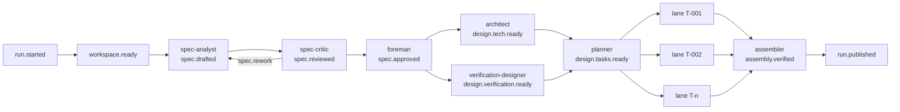

# sdd-factory

A spec-driven multi-agent software factory built on [Mozaik](https://docs.jigjoy.ai) (`@mozaik-ai/core` 4.1.0) for the JigJoy Software Factory track. One command turns a Markdown spec into a small TypeScript project (CLI or HTTP API) whose tests pass, and publishes it under `hidden/<slug>/`. Nobody writes code and nobody is consulted during a run: the operator pre-authorises the spec approval at launch, and every question a person would have answered is decided by an agent and recorded as an `ASSUMPTION` in the product's own spec. The factory applies [agent-sdd](https://github.com/cyberash-dev/agent-sdd) end to end: the product gets a typed, linted, approved specification before any code exists, every test carries an `@covers <record id>` marker, and `sdd ready` gates publication. The factory itself is built the same way (`spec/`, 7 partitions, every approved record covered by a test).

## Quick start

Requirements:

- Node 22.9 or newer (`npm run factory` uses `--env-file-if-exists`; preflight checks the major version; developed on Node 26), git, npm.
- The `claude` CLI on `PATH` and logged in: build lanes and the simple-fixer run `claude --print`.
- `OPENROUTER_API_KEY`: both shipped model profiles route every API role through OpenRouter. `ANTHROPIC_API_KEY` or `OPENAI_API_KEY` are needed only when `factory.config.json` names a direct Anthropic or OpenAI model id.
- `FACTORY_OPERATOR`: the human identity that owns the pre-authorised approvals (or `--operator`). Agent identities are refused.
- Optional `MOZAIK_API_KEY` (from [app.jigjoy.ai](https://app.jigjoy.ai)): mirrors the run live into Mozaik Cloud.

```sh
npm ci
cat > .env <<'EOF'
OPENROUTER_API_KEY=...
FACTORY_OPERATOR=<your identity>
MOZAIK_API_KEY=...            # optional
EOF
npm run factory -- run specs/todo-cli.md
```

`npm run factory` loads `.env` (git-ignored) when present. The run works in `.factory/runs/<slug>-<YYYYMMDD-HHMMSS>/` (`product/`, `worktrees/`, `handoffs/`, `trace/`, `state.json`, `run.json`). On success the verified product tree plus `trace/` is copied to `hidden/<slug>/`, committed in this repository as `factory: <slug> <runId>` and pushed to `origin`. `--no-push` keeps the commit local; `--out <dir>` publishes somewhere else. Sample inputs: `specs/todo-cli.md`, `specs/url-shortener-api.md`.

## Pipeline

| Stage | Role | Model (`factory.config.json`) | Runs as | Concurrency |
|---|---|---|---|---|
| spec | spec-analyst | `deepseek/deepseek-v4.1-flash-1017`, effort medium | Mozaik agent | loops on `sdd lint` (cap 8) |
| spec | spec-critic | `z-ai/glm-5.3-flash:nitro` | Mozaik agent, fresh context | after each draft (cap 4 rounds) |
| spec | foreman | none | deterministic Mozaik participant | runs `sdd approve` + `sdd finalize` |
| design | architect | DeepSeek V4.1 Flash, effort medium | Mozaik agent | in parallel with verification-designer |
| design | verification-designer | DeepSeek V4.1 Flash, effort high | Mozaik agent | in parallel with architect |
| design | planner | DeepSeek V4.1 Flash, effort medium | Mozaik agent | at the barrier after both |
| build | test-writer | `claude-sonnet-5-5`, effort medium | lane: Mozaik participant around `claude --print --safe-mode` | one lane per task, up to 4 lanes at once |
| build | Verifier (red / green check) | none | deterministic, foreman effect | per lane |
| build | implementer | `claude-sonnet-5-5`, effort medium | lane, fresh context | per lane |
| build | reviewer | DeepSeek V4.1 Flash | Mozaik agent | per lane, while other lanes code |
| assembly | assembler | none | deterministic Mozaik participant | once every task is approved |
| assembly | triage | DeepSeek V4.1 Flash, effort medium | Mozaik agent | on failures no lane owns |
| any | simple-fixer | `claude-opus-5-5`, effort medium | lane: Mozaik participant around `claude --print --safe-mode` | per failing unit, capped |
| any | tracer | none | deterministic Mozaik participant | every event |

1. **Spec.** The spec-analyst rewrites the Markdown input into a typed agent-sdd spec (`spec/spec.md` inside the product): one record per command, endpoint, behaviour, invariant or constraint, each with a test obligation. The spec-critic finds gaps and contradictions and decides every open question; the foreman then executes the approval the operator pre-authorised at launch.
2. **Design.** The architect maps records to modules and a toolchain (`design/tech.md`); the verification-designer turns every test obligation into input classes and negative oracles (`design/verification.md`). The planner reconciles both into `design/tasks.json`: disjoint write-sets, an acyclic dependency graph at most 3 tasks deep, every approved record covered exactly once. The graph is validated mechanically and the foreman installs the declared tooling before any lane starts.
3. **Build.** Each task runs in its own git worktree on branch `task/<id>`. The test-writer writes failing tests with `@covers` markers; the Verifier proves they fail for the right reason and freezes them; the implementer makes them green without touching tests; the Verifier runs typecheck and the full suite and checks the write-set; the reviewer checks the diff against the spec records and arbitrates test-versus-code disputes. Approved branches merge into `integration`.
4. **Assembly.** The assembler runs `npm ci`, `tsc`, `vitest` and `sdd ready` on `integration` and routes an attributed failure back to the owning lane, an unattributed one to triage.
5. **Publication.** Product tree plus `trace/` to `hidden/<slug>/`, commit, push.

The critic and the reviewer run on a different vendor's model than the roles whose output they judge, so judge and author share fewer blind spots.

## How agents run concurrently

Every event producer is a joined Mozaik participant, and every event is sent by the participant it names (`bus:BEH-007`). Deterministic roles (foreman, assembler, tracer) are Mozaik humans with situation handlers. LLM stage roles are Mozaik agents; each invocation is a `runLoop` with function tools, so `inference.*`, `function_call.*` and `model.answer` events come from Mozaik itself. Lane roles join as Mozaik participants per task for the lifetime of the lane and delegate their loop to a `claude --print` subprocess in the task's worktree; the subprocess is reported as `inference.started` / `inference.completed` of that participant, so concurrent lanes are visible as concurrent participants in the runtime roster and in Mozaik Cloud.



One lane: `task.ready` -> test-writer -> `task.tests_written` -> red check -> `task.tests_red` -> implementer -> `task.impl_done` -> green check -> `task.verified` -> reviewer -> `task.reviewed` -> `task.approved` -> merge into `integration`.

- **Design fan-out.** One `spec.approved` dispatch starts two Mozaik loops, architect and verification-designer. Their active intervals must overlap (`bus:INV-003`, contractual, tested in `tests/bus/design-concurrency.test.ts`). The planner starts at the barrier when both ready events are in.
- **Lane fan-out.** A task starts as soon as every task in its `dependsOn` is approved, up to `maxParallelLanes` active lanes (4 shipped, `--max-parallel-lanes <1..8>`). Independent ready tasks run their test-writers concurrently (`build-stage:INV-006`). Reviews of finished lanes run while other lanes are still coding.
- **Shared state.** The Mozaik runtime bus carries typed events, validated against the catalogue (`spec/bus.md`) at publication; an unknown type or a missing field throws. A pure transition function turns each event into a new `RunState`, written atomically to `state.json` after every transition, plus effects. Code is shared through git: one worktree per task, merged into `integration`. Roles hand results back through handoff files (`bus:CTR-007`).
- **Isolation.** Write-sets are pairwise disjoint (`design-stage:INV-002`). The critic never sees the analyst's reasoning. Design firewall: the architect never reads `design/verification.md`, the verification-designer reads `spec/spec.md` only; a forbidden read, detected from the tool log, re-runs the role once without that file and blocks the stage on a second one. During a repair the architect may read the task graph. The test-writer never reads `src/` beyond the stubs it is given; the implementer cannot change frozen tests or leave its write-set. Lanes run with `--safe-mode`, so the operator's own CLAUDE.md, skills, hooks and MCP servers never reach the product.

## Autonomy

The factory detects its own mistakes with deterministic oracles and recovers without a person:

- **Oracles:** `sdd lint` on the product spec, the red/green Verifier (typecheck, vitest JSON report, frozen-test and write-set checks), the `tasks.json` validator (coverage partition, disjoint write-sets, acyclic graph, depth and task-size bounds), and `sdd ready` at assembly.
- **Rework routing with caps.** A failure goes to the most upstream owner: spec, architect (`VD-INFEASIBLE`), planner (`TASK-OVERFLOW`, re-cut), test-writer or implementer (a `TEST-CONTRACT-CONFLICT` is arbitrated by the reviewer). Caps live in `factory.config.json`: implementer attempts 3, test-writer rework 1, planner re-cuts 2, architect repairs 2, assembly rounds 2, handoff re-runs 2.
- **Simple-fixer** (`factory:BEH-012`, `factory:CST-005`). Before a mechanical failure costs a role attempt, a capped Claude Code subprocess repairs it in place: invalid YAML in the product spec, an unparseable design file, a red-check typecheck or load error, a green-check typecheck or load failure, an assembly install, typecheck or load failure. The foreman snapshots the directory, diffs it after the run and reverts everything when a change leaves the allowed paths (frozen tests are never allowed) or alters parsed spec data; otherwise it re-runs the failing check. Each run publishes `fix.attempted`; at most 2 per owner and unit, then the original failure path applies.
- **Fallbacks.** A reviewer that produces no handoff after its re-runs is retried on `models.default` when that differs, then the foreman records `task.reviewed{decision: advisory_only}` and approves on the Verifier's green evidence; the gap is listed in `trace.md`. Triage without a handoff falls back the same way, then routes to a planner re-cut instead of failing the run. An API role that exceeds `timeouts.apiRoleMs` is re-run once with a "write the handoff first" note (`factory:BEH-011`). A rate-limited lane retries once after 30 s.
- **Watchdog** (`bus:DLT-007`). When nothing is in flight, the queue is empty and the run is not terminal for 2 s, the run fails as `run.failed{reason: stalled}` with every unfinished task in the detail, instead of hanging.
- **Resume and replay.** A failed run continues after a factory fix (see below); a cap that failed the run is granted one more attempt on resume.

Humans act only between runs, and every action is an event: `human.intervention{kind: launch}` (pre-authorisation, always line 1 of `interventions.md`), `fix_between_runs` (written by `factory resume`) and `mid_run_nudge` (recorded, never required). There are zero interactive steps inside a run (`factory:INV-001`).

## Transparency

Trace files are written to `.factory/runs/<runId>/trace/` during the run and published with the product in `hidden/<slug>/trace/`; secrets are redacted before every write.

- `trace.jsonl`: every bus and runtime event, append-only, in order.
- `trace.md`: header (operator, start, finish, outcome, `cloud:` link), a Stages table (start, end, duration, cost), a Tasks table (implementer and test-writer attempts, duration, cost, tokens, outcome, simple-fixes), totals, assumptions, interventions, warnings, and per-task and per-stage sections for fixer runs and advisory reviews.
- `costs.json`: the cost ledger the report totals are summed from.
- `interventions.md`: every human step.
- Per lane run: `handoffs/tasks/<taskId>/<role>-<attempt>/{handoff.md,transcript.jsonl}`, the redacted stream-json of the subprocess written line by line, so a killed lane still leaves evidence. API roles keep their final answer as `answer-run<N>.md`; fixer runs keep `answer-run<n>.md` and `transcript-run<n>.jsonl`.

With `MOZAIK_API_KEY` set, a `mozaik-cloud-exporter` participant forwards every event, redacted, to Mozaik Cloud; the session link is logged at start and written to `trace.md`. A failing mirror adds a warning line and never fails the run.

Cost caveat: API roles are priced from token usage with the `pricing` table in `factory.config.json`. Lane and fixer costs are the API-equivalent figures `claude --print` reports; on a Claude Code subscription nothing is billed per run.

## Results

<!-- numbers from the first published run go here -->

TODO

## Operating the factory

```sh
npm run factory -- run <spec.md> [--operator <id>] [--no-push] [--out <dir>] [--max-parallel-lanes <1..8>]
npm run factory -- resume <runId> [--note <text>] [--force] [--no-push] [--out <dir>] [--max-parallel-lanes <1..8>]
npm run factory -- replay <runId> (--event <seq> | --last)
npm run factory -- nudge <runId> --note <text>
```

- **resume** starts a new run that reuses the failed run's product, worktrees and handoffs, replays the bus trace through the pure transition rules (the whole chain when the failed run was itself a resume), cuts the failure chain (`task.failed`, `spec.blocked`, `design.blocked`, `run.failed`), records `fix_between_runs` and re-publishes the last effectful event plus the lane entry of every task that was in flight. A run that failed on an exhausted cap gets exactly one more attempt for that role. `--force` is required when `run.json` still says `running` (process killed with SIGKILL).
- **replay** rebuilds the state before one recorded event, executes that event's effects with real role runners and prints the events they would publish as JSON lines on stdout, without touching the trace, `state.json` or the cloud. `--last` picks the event resume would redo first. Use it to check a fix on the failed stage before resuming. Exit 0 when no printed event is `*.failed`, `*.blocked` or `*.rejected`, 1 otherwise, 2 for an unknown run or seq.
- **nudge** drops a note into a running run; it is published as `human.intervention{mid_run_nudge}`.
- **stop**: Ctrl-C or SIGTERM publishes `run.failed{reason: terminated}`, forwards the signal to running lanes, closes trace and cloud session and exits 1. The run is resumable without `--force`.

Exit codes: `0` published, `1` run failed (terminal report on stderr, evidence in `.factory/runs/<runId>/`), `2` usage or configuration error (unknown model id, provider without a key mapping), `3` environment error (Node below 22, missing API key, `claude` or `git` not on `PATH`).

**Configuration.** `factory.config.json` (template: `factory.config.example.json`) holds caps, timeouts (spec stage 40 min, API role 20 min, lane 25 min, verifier 5 min), `maxParallelLanes`, models and `pricing`. Model keys: `models.default` (spec-analyst, architect, verification-designer, planner), `critic`, `triage`, `reviewer` (falls back to `default` when null), `lanes.<test-writer|implementer|simple-fixer>` (falls back to `lane`, then the CLI default), and `effort.<role>` for API roles and lanes alike. Two profiles ship: `factory.config.json` (active, the cheap profile described above) and `factory.config.target.json` (`anthropic/claude-opus-5.5` as default with effort high for architect, verification-designer and planner, `openai/gpt-6.1-terra` for critic and reviewer, `openai/gpt-6-luna` for triage, same lanes). Switch with `cp factory.config.target.json factory.config.json`. Beyond Mozaik's bundled model list the factory registers `gpt-6.1-terra` (OpenAI) and the OpenRouter ids `deepseek/deepseek-v4.1-flash-1017`, `z-ai/glm-5.3-flash`, `z-ai/glm-5.3-flash:nitro`, `anthropic/claude-opus-5.5`, `openai/gpt-6.1-terra`, `openai/gpt-6-luna`.

## Developing the factory

```sh
npm test            # vitest: src/**/*.test.ts and tests/**/*.test.ts
npm run typecheck   # tsc --noEmit
npx sdd lint        # the factory's own spec
npx sdd ready --partition <bus|factory|trace|spec-stage|design-stage|build-stage|assembly-stage>
npx sdd record get <id>   # read one spec record, e.g. factory:BEH-012
```

- `spec/<partition>.md`: the factory's specification, one file per partition: `bus` (events, state, handoff protocol), `factory` (CLI, run lifecycle, resume, replay, simple-fixer), `trace` (trace files, costs, cloud mirror), `spec-stage`, `design-stage`, `build-stage`, `assembly-stage`. Behaviour changes land as approved `Delta` records first; tests carry `@covers <partition>:<id>`.
- `src/<partition>/`: one vertical slice per partition with `domain/` (pure transition rules), `application/` (effect handlers), `ports/` and `adapters/` (Mozaik runtime, git, subprocesses, trace files). `src/shared/` holds configuration, the API and CLI role runners, the simple-fixer and design-file parsers; `src/slices.ts` and `src/factory/application/compose.ts` wire the slices; `src/cli.ts` is the entry point.
- `prompts/<role>.md`: one prompt per role (spec-analyst, spec-critic, architect, verification-designer, planner, test-writer, implementer, reviewer, triage, simple-fixer). Every role must honour the handoff protocol `bus:CTR-007`.
- `tests/<partition>/`: integration and scripted-run tests per slice; unit tests sit next to the code.
